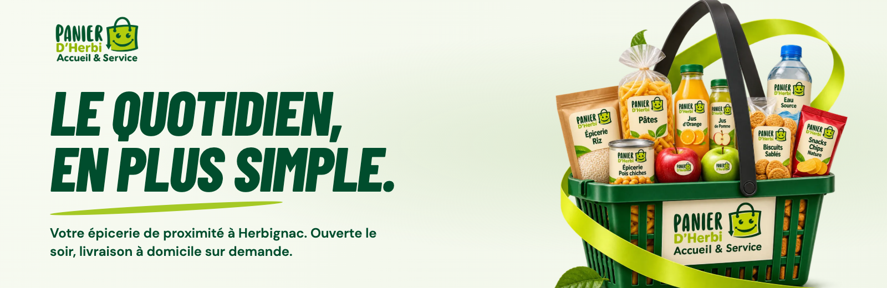
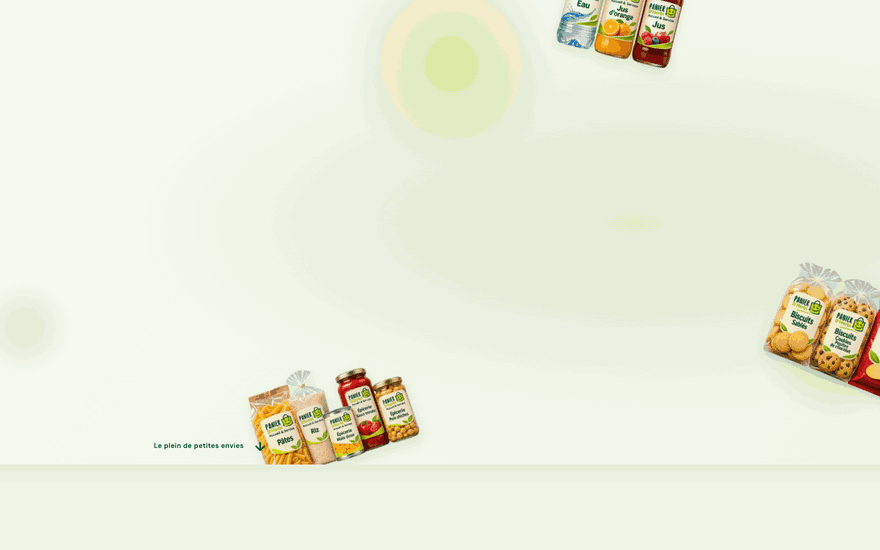
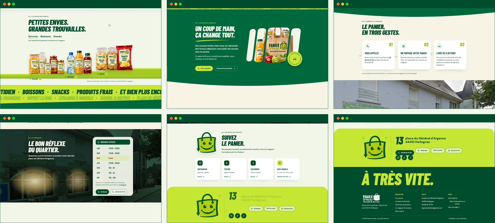
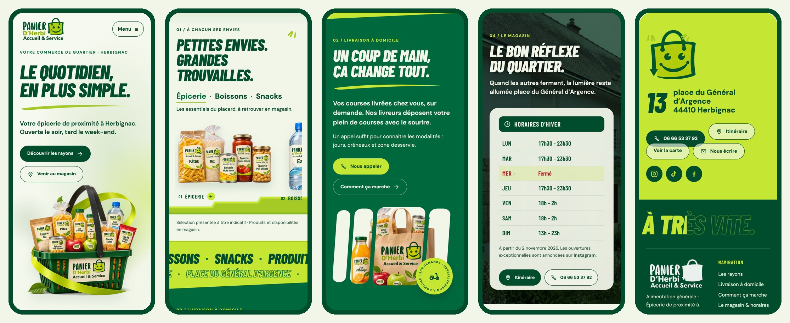

<div align="center">



<h3>A one-page website for a neighbourhood grocery in Herbignac, built around a basket that fills itself, tips over and pours its products onto the shelf.</h3>

<p>
  <a href="https://panier-d-herbi-herbignac.vercel.app"><strong>🌐 Live site</strong></a>
  &nbsp;·&nbsp;
  <a href="#hero-animation"><strong>🎬 How the hero works</strong></a>
  &nbsp;·&nbsp;
  <a href="#getting-started"><strong>🛠️ Run it locally</strong></a>
</p>

<p>
  <a href="https://panier-d-herbi-herbignac.vercel.app"></a>
  
  
  
  
</p>

</div>

<br />

## 🚀 Overview

**Panier d’Herbi** is the grocery that stays open when the others close: evenings every day but Wednesday, until 2 am on Friday and Saturday, with home delivery on request. The site turns that into one object and one story. A green shopping basket **fills itself** on arrival, **tips over** as you scroll and **pours** the épicerie, the drinks and the snacks onto a lime shelf. Further down the same basket lends its slats to a window on the delivery bag, the shop’s façade goes from day to dusk while its windows light up, and the smiling bag from the logo waves goodbye.

Everything on the page is a fact the shop already publishes: the winter hours from its Instagram notice, the delivery line from its Facebook page, the address, phone, e-mail and the three social accounts. Nothing is invented, no form pretends to send anything, and no external service loads before the visitor asks for it.

- **A single narrative object**: the basket opens the page, hands its contents to the shelf and comes back as slats, badge and mascot
- **One motion technique per section**: fill-and-pop, pour-and-land, velocity ribbons, opening slats, dealt cards, day-to-dusk, a wave, a drop and a fill
- **Direct actions only**: call, itinerary, map on request, e-mail, Instagram, TikTok, Facebook and a Google review link
- **Light and honest**: 160 KB on a desktop first load, 218 KB on a phone; the whole page reads without JavaScript and with reduced motion

<br />

<a name="hero-animation"></a>

## 🎬 The hero animation

<div align="center">
  <a href="https://panier-d-herbi-herbignac.vercel.app"></a>
  <sub>Intro at real speed, then a natural scroll on the live site · captured at 1440 × 900</sub>
</div>

<br />

The intro takes 1.5 s and never blocks: name, title and buttons are in place by 1.2 s, and a scroll skips straight to the end.

| Time / scroll | What happens                                                                                              |
| :------------ | :-------------------------------------------------------------------------------------------------------- |
| 0–0.75 s      | Épicerie, boissons and snacks fly in from three sides and shrink towards the basket’s centre              |
| 0.7–1.5 s     | They vanish into it; the basket pops to its size with a lime ring flash; the title rises letter by letter |
| 0.85–1.5 s    | Eyebrow, lead, buttons and navigation fade in; the basket then breathes (5 px, ±0.25°)                    |
| Scroll 0–100% | The copy drifts up, the basket lifts and tips 16° towards the next section, the light moves behind it     |
| Rayons enter  | The lime shelf draws itself from left to right and the three groups land on it one after another          |

**Under the hood**

- 🧺 **One composite, three cut-outs.** The basket is a single transparent WebP (the kit’s campaign master); the three product groups are the shelf’s own images, borrowed for the intro and released after it, so nothing downloads twice.
- 📐 **Board scale, never above.** The 1024 px board is shown whole: one unit `--u = min(1, width/1024, height/760)`, so the title is 80 px and the basket 620 px on any desktop and the hero is at most one screen tall (QA measures it at 1280 × 650 up to 1920 × 950).
- 🔁 **Hand-off by scroll, not by pin.** No section is pinned and the wheel is never hijacked. The pour is two scrubbed timelines that overlap: the basket tipping as the hero leaves, the groups landing as the shelf arrives.
- 🖱️ **Desktop only extras.** With a fine pointer, the basket tilts up to 9° towards the cursor and the background light drifts the other way.
- 🐢 **Graceful by default.** With `prefers-reduced-motion`, Save-Data or the pause button, the choreography is reverted entirely and the static page is what you see; the intro is also skipped when the page loads scrolled.

<br />

## 🖥️ Sections

<div align="center">
  
</div>

<br />

| #   | Section                              | Anchor       | Motion                                                                                       |
| :-- | :----------------------------------- | :----------- | :------------------------------------------------------------------------------------------- |
| 01  | **Le quotidien, en plus simple.**    | `#accueil`   | The basket fills itself, pops, breathes, then tips over                                      |
| 02  | **Petites envies. Grandes trouvailles.** | `#rayons` | The shelf draws itself; the three groups land; tabs select a group, a click opens a larger view |
| 03  | Ribbon of words                      | `#envies`    | Two marquees run against each other and speed up with the scroll (what the shop sells, in its own words) |
| 04  | **Un coup de main, ça change tout.** | `#livraison` | Four basket slats slide open on the delivery bag; the “Livraison à domicile” badge turns with the page |
| 05  | **Le panier, en trois gestes.**      | `#commande`  | Three cards are dealt in sequence, the dotted line links them                                 |
| 06  | **Le bon réflexe du quartier.**      | `#magasin`   | The real façade goes from day to dusk, its windows light up, the winter hours flip into place |
| 07  | **Suivez le panier.**                | `#suivre`    | The mascot arrives and waves; Instagram, TikTok, Facebook and Google-review cards rise       |
| 08  | **13 place du Général d’Argence**    | `#contact`   | The 13 drops in, the address slides, phone, itinerary, map and e-mail follow                 |
| 09  | Footer                               | n/a          | “À très vite.” fills in as the page ends                                                     |

<br />

## 📱 Mobile first, motion optional

<div align="center">
  
</div>

<br />

- Hero recomposed: title and buttons first, the basket (365 px) below, the whole thing in one screen at 390 × 844
- The shelf becomes a native horizontal scroll with snap; the tab you pick scrolls it, and the group you swipe to selects the tab
- Photo sections keep the image as a band at the top with the text on the solid colour
- Every touch target is at least 44 px; no horizontal scroll at 390 or 360 px; nothing depends on hover
- The intro also runs on phones, at 60 % amplitude; reduced motion disables it and the pause button in the footer

<br />

## ✨ Highlights

- **🎞️ Scroll storytelling with native scroll**: GSAP ScrollTrigger scrubs, no pinning, no smooth-scroll library, the wheel is never intercepted
- **🪟 Basket-slot window**: a `clipPath` in `objectBoundingBox` units, so the four slots stay sharp at any size; four covers open them one by one
- **🌆 Day to dusk on a real photo**: a multiply layer darkens the Street View façade while three screen-blend glows switch the windows on, driven by the scroll
- **🕒 Today’s row**: the hours table highlights the visitor’s weekday; no “open now” status is computed or promised
- **🗺️ Map on request**: Google Maps loads only after a click inside the dialog; Instagram, TikTok and Facebook are plain links
- **♿ Accessible components**: native `<dialog>` for the previews and the map, tablist with arrow keys for the rayons, skip link, focus return, visible focus on lime
- **🔎 Ready to share**: Open Graph image, `GroceryStore` structured data, favicons; `noindex` until the client goes live
- **🧪 118 browser checks**: `npm run qa` measures density at eight real windows, overflow, upscaled images, tiny text, every link target, real clicks on tabs, dialogs, sticky bar and pause button, the no-JS page and reduced motion

<br />

## 💻 Tech stack

| <br />HTML5 | <br />CSS3 | <br />JavaScript | <br />GSAP 3 | <br />Playwright | <br />Vercel |
| :---: | :---: | :---: | :---: | :---: | :---: |

### Why this stack?

- **Plain HTML, CSS and JavaScript, no build step**: the whole site is the `site/` folder; the static page is the base and the choreography is layered on top only while motion is on
- **GSAP ScrollTrigger (vendored)**: scrubbing, reversible timelines and refresh handling that stay solid across window sizes
- **Self-hosted Barlow Condensed and DM Sans**: the kit’s own faces, under the OFL, with no third-party font requests
- **Playwright + Chrome for Testing**: captures and QA at real browser windows and real scroll speed
- **Vercel**: every push to `main` deploys the `site/` folder

<br />

## 🎨 Design system

| Token          | Value                                                                                 | Use                                              |
| :------------- | :------------------------------------------------------------------------------------ | :----------------------------------------------- |
| Vert Panier    |           | Identity, delivery section                       |
| Vert profond   |           | Text, dark buttons, footer                       |
| Citron vert    |           | Ring, shelf, swooshes, focus                     |
| Lime clair     |           | Ribbon of words, contact block, badge            |
| Brume          |           | Page background, hours panel                     |
| Papier         |           | Three-steps section                              |

- **Type**: Barlow Condensed ExtraBold Italic for titles (80 px hero, 56–64 px sections, 56 px on phones), Barlow Condensed SemiBold for hours and indices, DM Sans for everything else (15 px body)
- **Scale**: a 1024 px board shown whole; every size is `px × --u`, with `--u ≤ 1`
- **Dividers, one per seam**: shelf step, flat band, slanted plane, curved seam, rounded photo top, rounded lime top
- **Motion**: entrances with `power3.out` / `power4.out` in 0.6–0.95 s, scrubs with 0.6–0.8 s smoothing, no scale above 1.03 on content

<br />

<a name="getting-started"></a>

## 🛠️ Getting started

```bash
# Clone the repository
git clone https://github.com/Jeanfr1/Panier-D-Herbi-website.git
cd Panier-D-Herbi-website

# Install the QA dependency (Node 20)
npm install

# Serve site/  →  http://localhost:4471
npm run dev

# Full-page captures at real windows  →  studio/shots/<tag>/
npm run shots

# Browser QA (118 checks)  →  studio/docs/browser-qa.json
npm run qa

# Intro + natural-scroll frames, one scene at a time
node scripts/scene-shots.mjs <tag> 1440x790 <fromY> <toY> <step> [intro]
```

<br />

## 📁 Project structure

```
Panier-D-Herbi-website/
├── site/                       # What goes live (static, no build)
│   ├── index.html              # Nine scenes: hero → rayons → ribbon → livraison → gestes → magasin → suivre → contact → footer
│   ├── styles.css              # Tokens, --u scale unit, every scene, phone composition, dialogs
│   ├── app.js                  # Scale unit, menu, rayons tabs + previews, map/infos dialogs, today’s row, sticky bar, motion switch
│   ├── motion.js               # GSAP choreography: intro, pour hand-off, ribbons, slats, cards, dusk, wave, drop, fill
│   ├── content.js              # Business facts (contacts, hours, rayons copy)
│   ├── images/                 # Campaign cut-outs and the façade (WebP)
│   ├── brand/                  # Logo, mascot, icons, Open Graph image
│   ├── fonts/                  # Barlow Condensed + DM Sans (OFL)
│   └── vendor/                 # gsap.min.js, ScrollTrigger.min.js (3.13)
├── scripts/                    # serve, shots, qa, scene-shots, motion-shots, readme-assets
├── images/campaign/ · brand/   # Kit masters (PNG)
├── references/ · roteiros/     # Approved board and the kit’s six scripts
├── docs/ · studio/             # Kit data; captures and QA output (studio/shots is not committed)
└── vercel.json                 # outputDirectory: site, noindex header, cache headers
```

<br />

## 🚀 Deployment

Hosted on **Vercel** and connected to this repository: every push to `main` ships the `site/` folder.

**Live site:** [panier-d-herbi-herbignac.vercel.app](https://panier-d-herbi-herbignac.vercel.app)

| Setting          | Value      |
| :--------------- | :--------- |
| Framework        | Other      |
| Build command    | none       |
| Output directory | `site`     |

<br />

## 📌 Content checklist

Items waiting on the client. Each one is marked `TODO(panier)` in `site/index.html`.

- [ ] Custom domain: then drop `noindex` (HTML, `vercel.json`, `robots.txt`), add `canonical` and `og:url`, move `og:image` to that domain
- [ ] The Facebook page URL (a Facebook search link stands in)
- [ ] The shop’s own façade photo to replace the Street View frame (© Google)
- [ ] Delivery terms (days, slots, area) before any are promised on the page
- [ ] Confirm the winter hours stay as published on Instagram (from 2 November 2026)

<br />

## 🙏 Acknowledgments

- **Panier d’Herbi** for the identity, the hours and the façade of the place du Général d’Argence
- **[GSAP](https://gsap.com)** for the scroll engine
- **[Barlow](https://fonts.google.com/specimen/Barlow+Condensed)** by Jeremy Tribby and **[DM Sans](https://fonts.google.com/specimen/DM+Sans)** by Colophon Foundry (OFL)
- **[Playwright](https://playwright.dev)** and **[Vercel](https://vercel.com)**

<br />

---

<div align="center">
  
  <p><strong>Le quotidien, en plus simple.</strong></p>
  <p>Built with ❤️ by <a href="https://github.com/Jeanfr1">Jean</a> for Panier d’Herbi</p>
  <sub>© 2026 Panier d’Herbi. All rights reserved.</sub>
</div>
